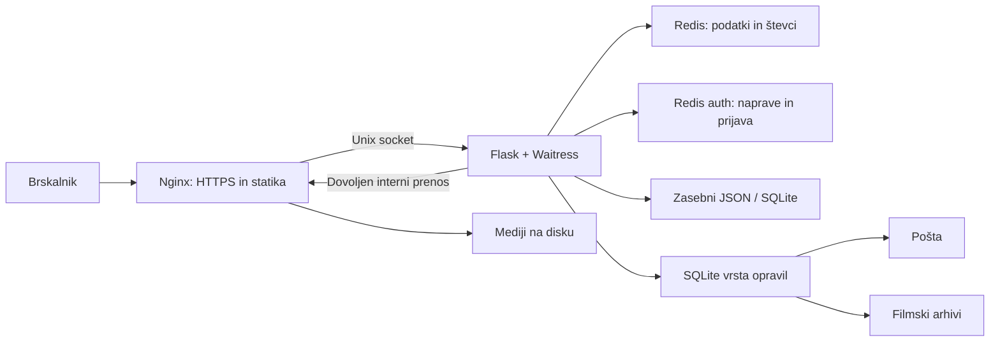

# Arhitektura aplikacije

## Pot zahteve

`src/app.py` sestavi aplikacijo, prijavo, zaščite in blueprinte.
Produkcijo zažene `src/serve.py`: štiri Waitress niti, Unix socket na zasebnem
Docker volumnu, zaupan samo Nginx proxy. Aplikacija nima javnega TCP vhoda.
Nginx streže statiko in dovoljene medije; dovoljenje za zasebne datoteke
pred prenosom preveri Flask. Datotek z gesli, pošto ali opravili ne objavljaj
z neposrednim Nginx `alias` na celotno `data/`.

## Komponente

| Del | Odgovornost |
| --- | --- |
| `blueprints/blog_bp.py`, `blog_content.py`, `blog_images.py` | Objave, naročnine, očiščen Markdown, različice slik |
| `blueprints/auth_bp.py`, `device_sessions.py` | Gesla, povabila, seje in omejitve naprav |
| `movie_media.py` | Enoten izbor epizod za predvajanje, prenose in metapodatke; HLS ima prednost pred istoimenskim MP4 |
| `blueprints/movies_bp.py`, `music_bp.py` | Katalogi, predvajanje, napredek in prenosi |
| `blueprints/admin_bp.py`, `fitness_bp.py` | Skrbniški vmesniki in zasebni podatki |
| `security_http.py` | Varnostne glave, omejitve zahtev, statistični števci |
| `runtime_jobs.py`, `background_jobs.py` | Trajna vrsta in obdelava pošte/arhivov |
| `content_preparation/`, `manual_editor.py` | Lokalna predpriprava; ločena od javnega strežnika |
| `scripts/setup.sh`, `scripts/security-update.sh` | Namestitev, preverjena posodobitev in obnova |

## Podatki in življenjski cikel

- JSON vsebuje zbirke in metapodatke; skupni zapisovalci zaklenejo celoten
  popravek ter zapisujejo atomsko. Ne spreminjaj istega produkcijskega JSON
  ročno med urejanjem skozi aplikacijo.
- Ločen Redis za prijave omogoča ločevanje sej od predpomnilnikov/statistike.
  Izguba evidence naprav zahteva novo prijavo.
- SQLite hrani trajna opravila in gibanje. Razvojna baza gibanja ter računi
  so ločeni; filmi, glasba in blog nimajo samodejno ločenih razvojnih kopij.
- `data/` in `cache/` nista del nespremenljive aplikacijske slike. Kopije
  morajo vključiti zasebne podatke in potrebne ključe; postopek obnove je v
  [varnostnih navodilih](security.md).
- Vsaka izdaja poveže aplikacijo s pripadajočo različico statike. Pri
  povrnitvi ne mešaj starih predlog z novo statiko.

## Vmesnik in vzdrževanje

Jinja predloge uporabljajo skupno glavo/nogo in ločeno skrbniško ogrodje.
JavaScript izboljša iskanje, dialoge in predvajalnike; običajni obrazci
obdržijo strežniško preverjanje. Medijski predvajalniki potrebujejo JavaScript.
CSP blokira inline dogodke; novo vedenje dodaj v lokalne skripte in uporabi
obstoječe CSRF postopke za spremembe podatkov.

Pri spremembi poti preveri prijavo in vlogo, pri obrazcu prazna/neveljavna
stanja in napake, pri opravilih nadaljevanje po osvežitvi oziroma ponovnem
zagonu. [Testiranje](installation.md#preverjanje-sprememb) in
[meritve na RPi](performance.md) pokrivajo različne plasti; uspešen test
brskalnika sam ne potrjuje produkcijske porabe RAM.
